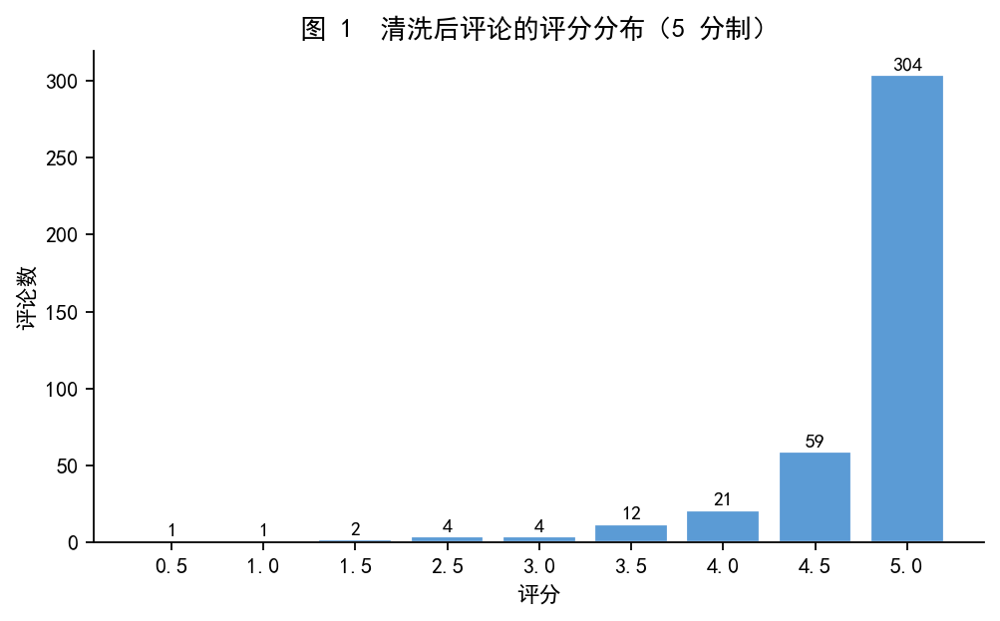
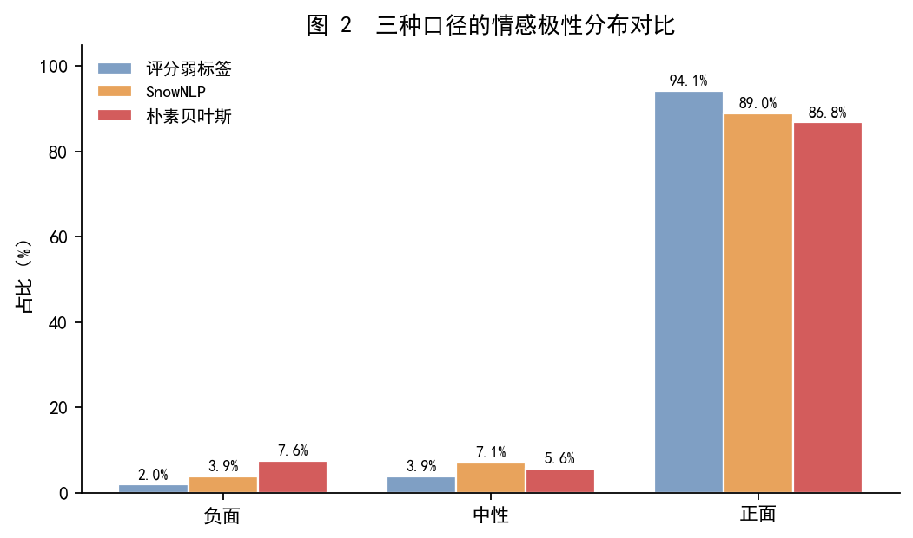
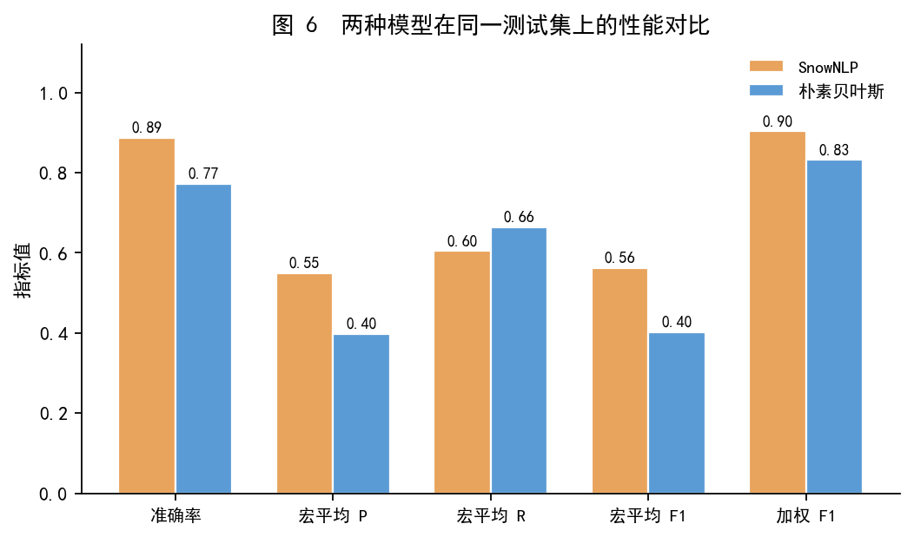

# 基于《西虹市首富》猫眼评论的文本情感分析

> 课程小组项目 · 《文本挖掘技术与应用》期末作品 · 2026
> 分析团队：罗丽燕、梁文秀

## 一句话简介

对猫眼电影《西虹市首富》的 **465 条**用户评论做采集 → 清洗 → 脱敏 → 中文预处理 →
双模型情感分析，并用 **SnowNLP（无监督）** 与 **TF-IDF + 朴素贝叶斯（有监督）**
两种方法在同一测试集上对比，最终输出情感态势分析与 9 张可视化图表
（清洗后有效样本 **408 条**）。

---

## ⚠️ 项目性质与本人贡献（请先读这一段）

这是**课程小组项目**，不是个人独立作品，如实说明分工：

| 模块 | 负责人 | 对应目录 |
|---|---|---|
| 评论采集（爬虫） | 组员 梁文秀 | `crawler/`（仅作流程完整性展示） |
| 数据清洗 / 去噪 / 脱敏 / 中文预处理 | **罗丽燕** | `src/analysis_pipeline.py` |
| SnowNLP + 朴素贝叶斯双模型与评估 | **罗丽燕** | `src/analysis_pipeline.py` |
| 全部可视化图表（9 张） | **罗丽燕** | `figures/` |
| 报告撰写（背景、方法、评估、讨论） | **罗丽燕**（营销/情感分析章节） | `report/` |

`crawler/` 下的采集代码由组员完成，此处保留是为了让"采集→清洗→建模→可视化"
链路完整可复现，**不代表本人工作**。

---

## 数据说明与隐私处理

- **来源**：猫眼电影《西虹市首富》影片页用户评论，评论时间跨度 2025-10-01 ~ 2026-10-18
- **原始字段**：用户昵称、评分（5 分制 / 0.5 步长）、评论内容、用户城市、评论时间
- **清洗结果**：465 条 → 408 条有效（剔除 1 条评分异常 + 10 条重复 + 46 条跨品类串评/乱码）
- **隐私合规**：
  - 用户昵称 → 加盐 SHA-256 哈希并截断为 `U` 开头 10 位不可逆代号（映射表不落盘、不交付）
  - 正文中的手机号 / 邮箱 / URL / @提及 / 微信 → 正则替换为 `[手机号]`、`[链接]` 等占位符
  - 本仓库**不公开任何可反查个人身份的原始昵称**

仓库内数据文件：

| 文件 | 说明 | 能否公开 |
|---|---|---|
| `data/maoyan_cleaned_senti.csv` | 清洗 + 脱敏 + 双模型结果（408 条，14 字段） | ✅ 已脱敏 |
| `data/sample_cleaned_40rows.csv` | 随机抽取 40 条脱敏样本，便于快速预览 | ✅ 已脱敏 |
| `maoyan_raw_xhs_city.csv`（仅本地，不在仓库内） | 原始采集文件（**含真实昵称，未脱敏**） | ❌ **禁止上传 GitHub** |
| `maoyan_西红柿首富.csv`（旧命名，仅本地） | 原始数据旧文件名，已统一为 `maoyan_raw_xhs_city.csv` | ❌ **禁止上传 GitHub** |

> 建议：`data/` 里两个文件正常上传；原始文件仅本地保留，或自行脱敏后再考虑公开。
>
> `.gitignore` 已用 `*raw*.csv` 拦截所有原始文件，并对两个脱敏文件设白名单，命令行 `git add` 也不会误传。

---

## 方法

| 方法 | 类型 | 标签来源 | 用途 |
|---|---|---|---|
| SnowNLP | 无监督，输出 [0,1] 连续情感分值 | 无需标注，阈值 ≥0.60 正面 / ≤0.40 负面（事先固定，不参与调参） | **主分析依据** |
| TF-IDF + MultinomialNB | 有监督，1-2 元词、2680 维特征、alpha=0.5 | 由评分派生弱标签（≥4.0 正面 / 3.0-3.9 中性 / <3.0 负面） | 对照验证 |
| 评分弱标签 | 事实参照 | 平台评分 | 校验基准 |

评估口径：7:3 分层留出测试集（n=123，random_state=42），指标以**宏平均 F1** 为主，
避免"全预测正面"在类别极不均衡（正面 94%）下刷高准确率。

---

## 核心结论

1. **整体情感明显偏正面**：SnowNLP 正面 363 条（88.97%）、中性 29 条（7.11%）、负面 16 条（3.92%）；
   平均情感分值 0.8519，平均评分 4.75（5 分制）
2. **口碑资产集中在三处**：搞笑（71 条提及）、剧情（58 条）、沈腾（31 条），
   喜剧密度 + 演员号召力是最稳定的正面主题
3. **争议点集中在**：原创性质疑（"好像国外片子有类似剧情"）、后半段节奏、笑点记忆点不足（"尬极了，没有记忆点"）
4. **方法对比结论**：SnowNLP 宏平均 F1 = 0.5627，优于朴素贝叶斯均匀先验版（0.4026）；
   朴素贝叶斯默认先验准确率最高（0.9350）但宏平均 F1 仅 0.3221 —— 几乎把所有样本预测为正面，
   是典型的"准确率陷阱"
5. **数据质量发现**：19 条评分与文本情感冲突（如 0.5 分配"非常完美的一部电影"），
   保留并标记，作为弱标签噪声来源在第 6 章专门讨论

---

## 可视化


*图 1 清洗后评论评分分布（5 分制）*


*图 2 评分弱标签 / SnowNLP / 朴素贝叶斯 三种口径情感极性分布*


*图 6 两种模型在同一测试集上的性能对比*

---

## 运行方式

```bash
# 1. 安装依赖
pip install -r requirements.txt

# 2. 一键复现（仓库已含脱敏数据，直接可跑）
python src/analysis_pipeline.py
```

> 数据路径已写为 `data/maoyan_cleaned_senti.csv`（项目根相对定位），
> clone 后无需改动任何配置即可运行。

**若要从头重跑采集 → 清洗全链路**（可选，仅本地）：

```bash
# a. 采集（组员脚本，输出到 data/，含真实昵称，禁止上传）
python crawler/maoyan_crawler.py

# b. 清洗 + 脱敏后的文件需手动改名为 maoyan_cleaned_senti.csv 放入 data/
# c. 再执行 python src/analysis_pipeline.py
```

运行后生成／覆盖：

- `data/maoyan_cleaned_senti.csv`（清洗+脱敏+双模型结果，408 条）
- `stats.json`（报告所需的全部统计口径）
- `figures/*.png`（9 张图表）

---

## 项目结构

```
movie-review-text-mining/
├── README.md                        # 本文件
├── requirements.txt                 # Python 依赖
├── .gitignore                       # 排除原始数据 / 缓存 / 密钥
├── data/
│   ├── README.md                    # 数据说明与脱敏规则
│   ├── maoyan_cleaned_senti.csv     # 清洗+脱敏结果（408 条，已脱敏可公开）
│   └── sample_cleaned_40rows.csv    # 40 条脱敏预览样本
├── crawler/
│   ├── README.md                    # 采集模块说明（组员完成）
│   └── maoyan_crawler.py            # 采集脚本（限速 + UA 轮换，不持续压测平台）
│   │                                # ⚠ 输出原始数据默认落 data/，文件名 *raw*.csv 已被 .gitignore 拦截
├── src/
│   └── analysis_pipeline.py         # 主分析管线：清洗/脱敏/分词/建模/评估/出图
├── figures/                         # 9 张可视化图表
│   ├── fig01_rating_dist.png
│   ├── fig02_polarity_compare.png
│   ├── fig03_snow_score_dist.png
│   ├── fig04_snow_by_rating_box.png
│   ├── fig05_nb_confusion_matrix.png
│   ├── fig06_model_metrics.png
│   ├── fig07_monthly_trend.png
│   ├── fig08_city_top10.png
│   └── fig09_theme_words.png
├── report/
│   └── movie-review-text-mining-report.pdf    # 课程报告（PDF版，含完整分析过程）
└── stats.json                       # 运行产出：全部统计口径
```

---

## 局限与后续改进

- **标签局限**：参照基准是平台评分派生的弱标签，非人工标注金标准，因此表 6-1 更应理解为
  "与评分的一致程度"，而非绝对情感分类准确率
- **模型局限**：SnowNLP 预训练语料偏商品评论，对影视反讽、方言梗敏感度有限
- **数据局限**：408 条短文本（平均 5.96 个有效词）不适用于 LSTM/BERT 等深度模型，易过拟合；
  且存在自选择偏差（愿意打分的用户更倾向好评），结论只代表"猫眼活跃评论者意见结构"
- **改进方向**：
  1. 人工标注 200-300 条分层样本构建金标准
  2. 引入中文 BERT 等影视领域预训练模型 + 少数类重采样
  3. 把表情符号、反讽与口语夸张表达纳入领域情感词典
  4. 补 SHAP / 特征词权重做可解释性分析

---

## 技术栈

Python 3.10 · pandas · jieba · SnowNLP · scikit-learn · matplotlib
